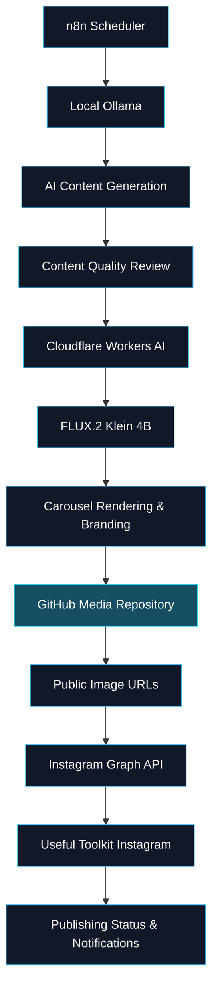

 <div align="center">

# ◈ USEFUL TOOLKIT
### INSTAGRAM MEDIA ENGINE

**AI-generated visuals. Automated publishing. Open infrastructure.**

A media asset repository powering the automated Instagram publishing pipeline for **Useful Toolkit**, built with local AI, Cloudflare Workers AI, n8n, and GitHub.

[](https://github.com/vaibcc)
[](https://www.instagram.com/useful.toolkit/)
[](https://n8n.io/)
[](https://developers.cloudflare.com/workers-ai/)
[](#license--usage)

**[VAIB.CC](https://vaib.cc) · [Instagram](https://www.instagram.com/useful.toolkit/) · [GitHub](https://github.com/vaibcc)**

</div>

---

## Overview

**Useful Toolkit Instagram Media Engine** is the public asset storage layer for an automated, AI-powered content publishing system.

The project combines local large language models, cloud-hosted image generation, deterministic graphic composition, and workflow orchestration to produce visually consistent educational content.

Its primary purpose is to provide publicly accessible image URLs for Instagram publishing without relying on paid image-hosting infrastructure.

> **Infrastructure principle:** Local-first intelligence, cloud-assisted image generation, automated delivery, and zero additional subscription costs.

## System Architecture



*Architecture target. Components are integrated progressively and production scheduling is enabled only after validation.*

## Technology Stack

| Component | Technology | Responsibility |
|---|---|---|
| Workflow orchestration | n8n (self-hosted) | Scheduling, execution, integration |
| Content intelligence | Ollama + Qwen | Topics, captions, educational content |
| Content review | Ollama + Gemma | Quality and factual validation |
| Image generation | Cloudflare Workers AI | Serverless image inference |
| Image model | FLUX.2 Klein 4B | AI-generated visual backgrounds |
| Graphic composition | Local rendering pipeline | Typography, layouts, branding |
| Media hosting | GitHub | Public image asset storage |
| Publishing | Instagram API | Image and carousel publication |
| Notifications | Telegram | Operational reporting |

## Visual Identity

The media engine follows a consistent visual language designed for technology-focused educational content.

| Design Element | Specification |
|---|---|
| Primary background | Midnight Navy `#080D1A` |
| Secondary background | Deep Slate `#111827` |
| Primary accent | Electric Blue `#2563EB` |
| Secondary accent | Cyan `#22D3EE` |
| Primary typography | White `#F8FAFC` |
| Secondary typography | Slate `#94A3B8` |
| Composition | Minimal, structured, editorial |
| Content formats | Single-image posts and multi-slide carousels |

**Design philosophy**

- Clear hierarchy and readable educational content.
- Consistent branding across posts.
- High-quality AI-generated visual assets.
- Deterministic text overlays rather than AI-generated typography.
- Mobile-first composition for Instagram.

## Repository Structure

```text
useful-toolkit-instagram-media/
│
├── README.md
│
└── images/
    ├── .gitkeep
    │
    ├── YYYY/
    │   └── MM/
    │       └── post-slug/
    │           ├── slide-01.jpg
    │           ├── slide-02.jpg
    │           ├── slide-03.jpg
    │           ├── slide-04.jpg
    │           ├── slide-05.jpg
    │           └── slide-06.jpg
    │
    └── singles/
        └── post-slug.jpg
```

*The directory structure above is the planned production convention. Media directories are populated automatically by the publishing workflow.*

## Media Delivery

Each generated image is stored in this public GitHub repository and made accessible through a raw content URL.

**Example URL pattern:**

```text
https://raw.githubusercontent.com/vaibcc/useful-toolkit-instagram-media/main/images/YYYY/MM/post-slug/slide-01.jpg
```

The publishing workflow uses these URLs to provide externally accessible media to Instagram.

### Asset Requirements

- JPEG image output.
- Instagram-compatible dimensions and aspect ratios.
- Consistent carousel dimensions within each post.
- Descriptive, unique filenames.
- Publicly accessible HTTPS URLs.
- No credentials or private metadata embedded in assets.

GitHub raw URLs are used as a lightweight media delivery mechanism. This repository is not intended to replace a dedicated CDN for high-volume commercial workloads.

## Automation Lifecycle

**01 · Discover**

The workflow selects useful technology topics, productivity techniques, AI tools, and practical tutorials.

**02 · Generate**

Local language models prepare captions, slide narratives, and image-generation prompts.

**03 · Validate**

A secondary AI review checks content quality, clarity, and consistency.

**04 · Illustrate**

FLUX.2 Klein 4B generates the visual assets through Cloudflare Workers AI.

**05 · Compose**

The rendering pipeline applies typography, brand colors, slide numbering, and layout rules.

**06 · Store**

Final images are uploaded to this repository with predictable paths and unique filenames.

**07 · Publish**

Instagram retrieves the publicly hosted assets and publishes the prepared content.

**08 · Monitor**

Execution status and publishing failures are reported through the automation system.

## Planned Publishing Strategy

| Time (Europe/Paris) | Content Category | Format |
|---|---|---|
| 08:00 | AI tools and discoveries | 6-slide carousel |
| 13:00 | Productivity and practical tips | Single image |
| 19:00 | Technology and cybersecurity | 6-slide carousel |

Publishing times and formats are configuration targets and may change based on operational results.

## Cost Model

The infrastructure is designed to operate without additional paid subscriptions.

| Service | Usage Strategy |
|---|---|
| Ollama | Existing local infrastructure |
| n8n | Existing self-hosted instance |
| Cloudflare Workers AI | Free daily Neuron allowance |
| GitHub | Public repository |
| Instagram API | Existing publishing integration |

Free-tier limits, acceptable-use requirements, and provider policies still apply. Automated workflows should stop rather than switch to paid inference when free capacity is exhausted.

## Security & Operational Controls

The publishing system is designed around the following controls:

- Credentials stored in n8n's credential manager.
- Least-privilege access for external services.
- No API keys or access tokens committed to GitHub.
- Separation of public media assets and private workflow configuration.
- Validation of generated content before publication.
- Duplicate-publication prevention.
- Error handling and operational notifications.
- Monitoring of free-tier API usage.

**This repository contains public media assets only.** It must never contain credentials, private prompts containing sensitive information, internal infrastructure configuration, or unpublished confidential material.

## Project Status

| Component | Status |
|---|---|
| Cloudflare FLUX.2 image generation | Verified |
| Instagram single-image publishing | Verified |
| GitHub repository | Created |
| Automated image uploads | Verified (single-image GitHub API upload) |
| Carousel rendering | Planned |
| Automated carousel publishing | Planned |
| Production scheduling | Not activated |

## Roadmap

- [x] Establish Cloudflare Workers AI connectivity.
- [x] Generate an image using FLUX.2 Klein 4B.
- [x] Verify Instagram API single-image publishing.
- [x] Create public media repository.
- [x] Implement automated GitHub image uploads (single-image test verified on 2026-11-19).
- [ ] Implement consistent carousel composition.
- [ ] Integrate local AI content generation and review.
- [ ] Validate end-to-end carousel publishing.
- [ ] Implement failure handling and usage monitoring.
- [ ] Enable production scheduling.

## About Useful Toolkit

**Useful Toolkit** explores practical tools, automation, artificial intelligence, productivity, and cybersecurity.

The objective is to make useful technology easier to discover, understand, and apply through concise, visually structured content.

Built and maintained as part of the **VAIB.CC** technology ecosystem.

**Website:** https://vaib.cc

**Instagram:** https://www.instagram.com/useful.toolkit/

**GitHub:** https://github.com/vaibcc

## License & Usage

Unless explicitly stated otherwise, generated media assets, original branding, and repository-specific creative materials are **all rights reserved**.

Public availability does not grant permission to redistribute, resell, or commercially reuse the media.

Third-party trademarks, tools, and referenced technologies remain the property of their respective owners.

---

<div align="center">

### USEFUL TOOLKIT

**Discover better tools. Build smarter workflows.**

Powered by **VAIB.CC**

[Website](https://vaib.cc) · [Instagram](https://www.instagram.com/useful.toolkit/) · [GitHub](https://github.com/vaibcc)

<sub>Designed for automation. Built for consistency. Engineered to scale.</sub>

</div> 
